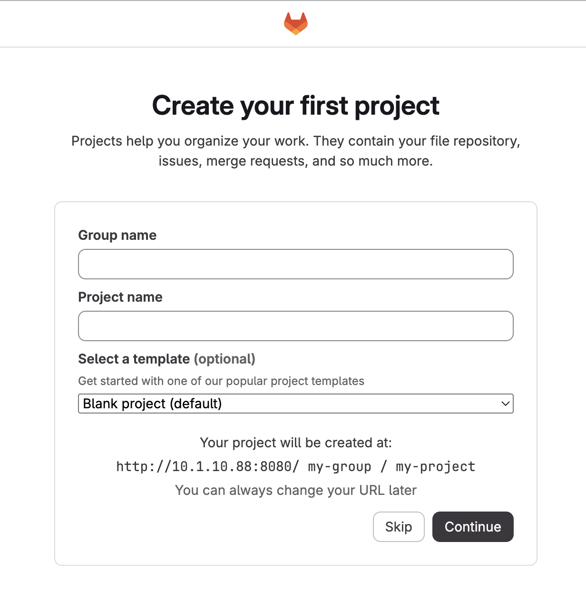
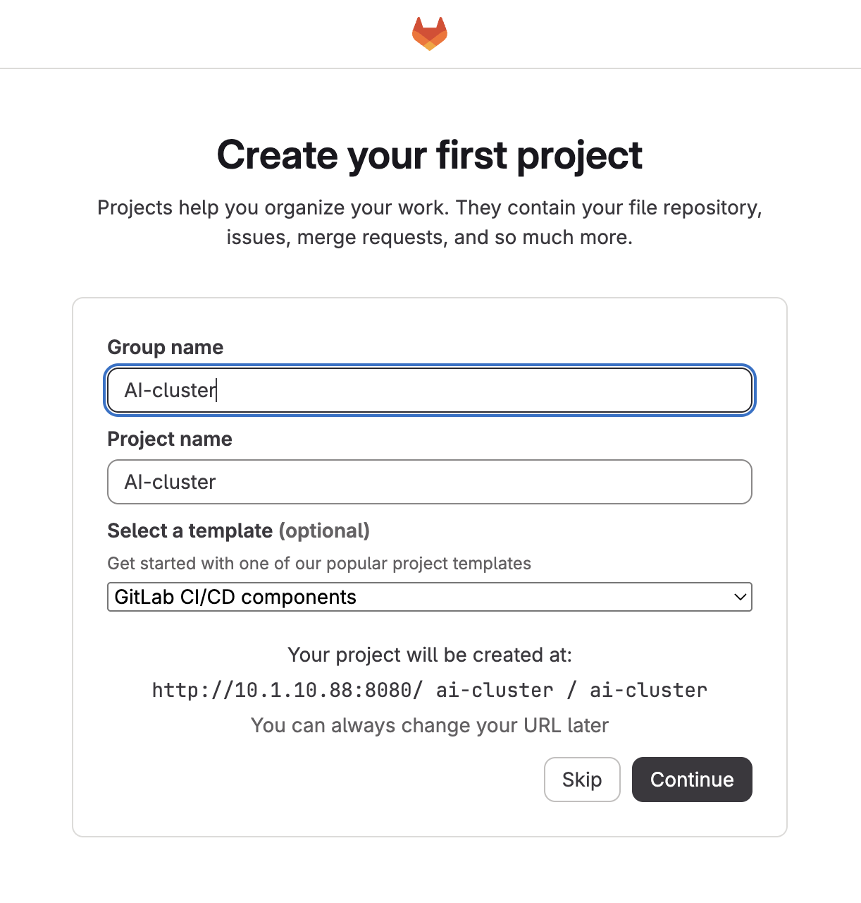
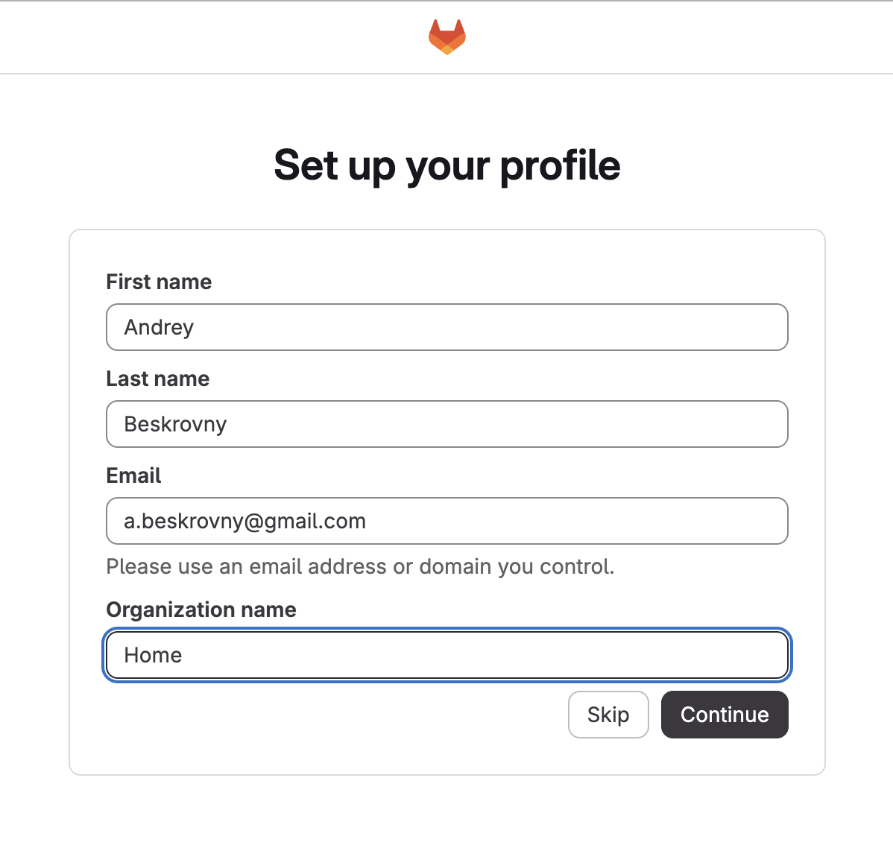

# Установка GitLab и GitLab Runner
Для локального контура оптимально развернуть self-hosted GitLab и отдельный Runner, который будет иметь сетевой доступ как к NetBox, так и к сетевому оборудованию.

Развертывание GitLab CE начнем с создания директории контейнера:
```bash
sudo mkdir /opt/gitlab-docker && cd /opt/gitlab-docker/
```

Создадим самостоятельно файл `docker-compose.yml` (потребуется минимум 4 ГБ ОЗУ):
```yaml
services:
  gitlab:
    image: gitlab/gitlab-ce:latest
    restart: on-failure
    container_name: gitlab
    restart: always
    hostname: 'gitlab.local'
    environment:
      GITLAB_OMNIBUS_CONFIG: |
        external_url 'http://gitlab.local'
    ports:
      - '10.1.111.14:80:80'
      - '10.1.111.14:443:443'
      - '10.1.111.14:2222:22'
    networks:
      - default
      - gitopsnet
    volumes:
      - './config:/etc/gitlab'
      - './logs:/var/log/gitlab'
      - './data:/var/opt/gitlab'
    shm_size: '256m'

networks:
  gitopsnet:
    external: true
```

> Следует изначально указать правильное имя хоста, чтобы при редиректе не получать ошибки связанные с недоступностью хоста.

Я сразу вешаю его на IP-адрес, определенный для него в [части](https://github.com/abeskrovny/IaaC/blob/main/Prepare.md).  

Запускаем контейнер командой `docker compose up -d`.

Пароль пользователя `root` после инициализации можно узнать командой `sudo docker exec -it gitlab grep 'Password:' /etc/gitlab/initial_root_password`:
```bash
admin@srvOoBService01:/opt/gitlab-docker$ sudo docker exec -it gitlab grep 'Password:' /etc/gitlab/initial_root_password         
Password: 3AZnsGbzlxrqAf385ikNm1LVIr1PVE9nDg2NSJUziJs=
```

Используя учетную запись `root` и полученный пароль, производим первый вход в систему:



перед подключением раннера (GitLab Runner) лучше завершить базовую инициализацию и выполнить пару важных настроек самого GitLab, чтобы раннер смог без проблем регистрироваться и забирать код.

Для NetGitOps (управления сетевой инфраструктурой как кодом: Ansible, Nornir, Terraform, конфигурации свитчей/роутеров, выгрузка данных в NetBox) лучше всего не выбирать никакой шаблон — то есть нажать Skip на текущем экране и создать пустой проект (Blank project).



Почему не стоит брать готовые шаблоны из списка:
• GitLab CI/CD components (который выбран на скриншоте) предназначен для разработки переиспользуемых плагинов для самого GitLab, а не для хранения конфигураций сети или плейбуков.
• Остальные встроенные шаблоны (Spring, Ruby, Pages и др.) добавляют в репозиторий лишние файлы, папки и настройки сборки под разработку ПО, которые будут только мешать.



Как лучше организовать проект под NetGitOps:
1. На текущем экране нажмите Skip, чтобы пропустить мастер создания с шаблоном.
2. Зайдите в раздел Groups и создайте группу AI-cluster вручную (если она еще не создалась).
3. Внутри группы нажмите New project → Create blank project.
4. Снимите галочку Initialize repository with a README, если планируете залить (сделать git push) уже существующий локальный репозиторий с вашими плейбуками, ролями Ansible и инвентарем. Если начинаете с нуля — оставьте галочку включенной.
После создания чистого репозитория вы просто добавите в корень свой файл .gitlab-ci.yml, который будет запускать линтеры (yamllint, ansible-lint), проверки конфигураций (batfish, --check) и накат изменений на сетевое оборудование через ваш раннер.

GitLab Runner обязательно нужен, и развертывать его следует на отдельном выделенном сервере или виртуальной машине под управлением Ubuntu в вашей сети управления (Out-of-Band). Сам GitLab только хранит код и управляет очередью задач, а всю реальную работу выполняет именно раннер.


Зачем нужен GitLab Runner в NetGitOps

Без раннера пайплайн в GitLab не запустится и останется висеть в статусе Pending. В сетевой автоматизации он выполняет роль «рабочих рук»:
• Связующее звено. Раннер стоит в одной сети с вашим оборудованием, забирает данные из NetBox по API и подключается к коммутаторам по SSH или eAPI.
• Среда исполнения. Он поднимает изолированный Docker-контейнер со всеми нужными инструментами (Ansible, Python, линтеры, Batfish) и запускает внутри него ваши плейбуки.
• Безопасность. Вам не нужно открывать доступ извне к сети управления коммутаторами. Раннер сам инициирует исходящее HTTPS-соединение к GitLab для получения задач.

На чем и как его развертывать

Не рекомендуется ставить раннер на тот же сервер, где крутится сам GitLab, из-за высоких требований к памяти. Оптимальный вариант — отдельная ВМ на Ubuntu Server (достаточно 2 vCPU, 4 ГБ RAM и 30–40 ГБ диска для кэша Docker-образов).

Процесс развертывания состоит из четырех шагов.

1. Установка Docker на сервер Ubuntu

Раннер будет запускать задачи в контейнерах, поэтому сначала ставим Docker:
```bash
sudo apt update
sudo apt upgrade
sudo apt install -y ca-certificates curl gnupg
sudo install -m 0755 -d /etc/apt/keyrings
sudo curl -fsSL https://download.docker.com/linux/ubuntu/gpg -o /etc/apt/keyrings/docker.asc
```

Проверим, что получили:
```bash
admin@srvOoBService01:/opt/netbox-docker$ cat /etc/apt/keyrings/docker.asc 
-----BEGIN PGP PUBLIC KEY BLOCK-----

mQINBFit2ioBEADhWpZ8/wvZ6hUTiXOwQHXMAlaFHcPH9hAtr4F1y2+OYdbtMuth
lqqwp028AqyY+PRfVMtSYMbjuQuu5byyKR01BbqYhuS3jtqQmljZ/bJvXqnmiVXh
38UuLa+z077PxyxQhu5BbqntTPQMfiyqEiU+BKbq2WmANUKQf+1AmZY/IruOXbnq
...
M8ssD1jFheOJf3hODnkKU+HKjvMROl1DK7zdmLdNzA1cvtZH/nCC9KPj1z8QC47S
xx+dTZSx4ONAhwbS/LN3PoKtn8LPjY9NP9uDWI+TWYquS2U+KHDrBDlsgozDbs/O
jCxcpDzNmXpWQHEtHU7649OXHP7UeNST1mCUCH5qdank0V1iejF6/CfTFU4MfcrG
YT90qFF93M3v01BbxP+EIY2/9tiIPbrd
=0YYh
-----END PGP PUBLIC KEY BLOCK-----
```

```
echo \
  "deb [arch=$(dpkg --print-architecture) signed-by=/etc/apt/keyrings/docker.gpg] https://download.docker.com/linux/ubuntu/dists/ \
  $(. /etc/os-release && echo "$VERSION_CODENAME") stable" | \
  sudo tee /etc/apt/sources.list.d/docker.list > /dev/null
```

-=-=-=

echo "deb [arch=amd64 signed-by=/etc/apt/keyrings/docker.gpg] https://download.docker.com/linux/ubuntu resolute stable" | sudo tee /etc/apt/sources.list.d/docker.list

Ошибка Connection failed [IP: 3.174.2.110 443] подтверждает, что сервер srvOoBService01 физически не может установить TCP-соединение с IP-адресами AWS CloudFront (3.174.2.110, 3.174.2.112) на 443 порту из-за сетевой блокировки (Geo-IP / DPI / ограничения на уровне шлюза или провайдера).

echo "deb [arch=amd64 signed-by=/etc/apt/keyrings/docker.gpg] https://mirror.yandex.ru/mirrors/download.docker.com/linux/ubuntu resolute stable" | sudo tee /etc/apt/sources.list.d/docker.list

ебаный путин!!!

Зеркало Яндекса отлично заработало и отдало индекс репозитория resolute, а ошибка NO_PUBKEY 7EA0A9C3F273FCD8 возникла из-за того, что файл ключа /etc/apt/keyrings/docker.gpg пустой или отсутствует (в прошлый раз его загрузка с docker.com сорвалась).

sudo mkdir -p /etc/apt/keyrings
curl -fsSL https://mirror.yandex.ru/mirrors/download.docker.com/linux/ubuntu/gpg | sudo gpg --dearmor --yes -o /etc/apt/keyrings/docker.gpg
sudo chmod a+r /etc/apt/keyrings/docker.gpg


sudo apt update
sudo apt install -y docker-ce docker-ce-cli containerd.io

Ошибка dpkg возникла из-за конфликта пакетов: новый официальный плагин docker-compose-plugin пытается перезаписать файл /usr/libexec/docker/cli-plugins/docker-compose, который уже принадлежит старому пакету Ubuntu docker-compose-v2.
Все нужные .deb-пакеты уже скачаны в локальный кэш сервера (/var/cache/apt/archives/), поэтому заново качать 102 МБ целый час не придется.

• Удалите конфликтующий пакет из стандартного репозитория Ubuntu:

sudo apt remove -y docker-compose-v2

sudo apt --fix-broken install -y

sudo apt install -y docker-compose-plugin

Убедитесь, что службы запустились и версии корректны:bash

admin@srvOoBService01:/opt/netbox-docker$ docker --version
Docker version 29.9.3, build 5457199
admin@srvOoBService01:/opt/netbox-docker$ docker compose version
Docker Compose version v5.7.1

Переходим к установке runner'а:

sudo apt update && sudo apt install -y curl gnupg

curl -fsSL https://packages.gitlab.com/runner/gitlab-runner/gpgkey | sudo gpg --dearmor --yes -o /etc/apt/keyrings/gitlab-runner.gpg
sudo chmod a+r /etc/apt/keyrings/gitlab-runner.gpg


Добавление репозитория

Этот блок декодирует правильную строку с URL репозитория и записывает её в /etc/apt/sources.list.d/gitlab-runner.list:

echo "deb [signed-by=/etc/apt/keyrings/gitlab-runner.gpg] https://packages.gitlab.com/runner/gitlab-runner/ubuntu/ resolute main" | sudo tee /etc/apt/sources.list.d/gitlab-runner.list

sudo apt update
sudo apt install -y gitlab-runner

-=-=-=-


Создание раннера в интерфейсе GitLab

В современных версиях GitLab старый способ регистрации через общий токен устарел. Теперь раннер создается прямо в интерфейсе:
1. Зайдите в вашу группу или проект в GitLab.
2. Перейдите в Settings -> CI/CD -> Runners (в правом меню "Настройки" -> CI/CD -> "Средства выполнения") и нажмите New group runner (или New project runner).
3. Укажите тег, например `netgitops` (по нему пайплайны будут понимать, что задачу нужно отдать именно этому серверу).
4. Нажмите Create runner и скопируйте выданную команду регистрации с токеном вида glrt-....

На стадии 3 после нажатия на кнопку создания runner'а, GitLab производит редирект по DNS-имени, которое для нас остается неразрешенным.

Проблема возникает из-за того, что в конфигурации самого GitLab указан внутренний адрес `http://gitlab.local`. Когда GitLab генерирует ссылки для редиректов (в том числе при регистрации раннера), он берет базовый URL из параметра `external_url`.

Я попробовал несколько вариантов с переконфигурацией, но так как мой GitLab работает в виртуальной среде EVE-NG и публикуется через DNAT, мне проще было на стороне "внешней" системы поправить адрес на `http://10.1.10.88:8080/ai-cluster-group/dc/-/runners/3/register`.

В настройках оставляем чекбокс на Linux (Операционная система раннера) на п. 4:
```bash
sudo gitlab-runner register  --url http://localhost:8080  --token glrt-eWJuhAleCWGicQ2aCCF5MG86MQpwOjIKdDozCnU6MQ8.01.170mqfbsj
```

так как в docker-compose.yml у нас определен порт:
```
    ports:
      - '8080:80'
```

На интерактивные вопросы в консоли ответьте так:
• Enter the GitLab instance URL: просто нажмите Enter (подхватится из флага)???
• Enter a name for the runner: введите имя, например oob-ubuntu-runner???
• Enter an executor: напишите docker.
• Enter the default Docker image: укажите базовый образ, например python:3.11-slim.

```bash
admin@srvOoBService01:/opt/netbox-docker$ sudo gitlab-runner register  --url http://localhost:8080  --token glrt-eWJuhAleCWGicQ2aCCF5MG86MQpwOjIKdDozCnU6MQ8.01.170mqfbsj
Runtime platform                                    arch=amd64 os=linux pid=651784 revision=33227fd4 version=19.5.3
Running in system-mode.                            
                                                   
Enter the GitLab instance URL (for example, https://gitlab.com/):
[http://localhost:8080]: <ENTER>
Verifying runner... is valid                        correlation_id=01M7QMKDWEJTXDC209DK6KJFQP runner=eWJuhAleC runner_name=srvOoBService01
Enter a name for the runner. This is stored only in the local config.toml file:
[srvOoBService01]: <ENTER>
Enter an executor: shell, custom, instance, docker, docker-windows, docker-autoscaler, docker+machine, kubernetes, ssh, parallels, virtualbox: docker <ENTER>
Enter the default Docker image (for example, ruby:3.3): python:3.11-slim <ENTER>
Runner registered successfully. Feel free to start it, but if it's running already the config should be automatically reloaded!
 
Configuration (with the authentication token) was saved in "/etc/gitlab-runner/config.toml"
```

После этого проверьте статус службы командой `sudo gitlab-runner status`. В веб-интерфейсе GitLab напротив вашего раннера должен загореться зеленый кружок Online.
```bash
admin@srvOoBService01:/opt/netbox-docker$ sudo gitlab-runner status
Runtime platform                                    arch=amd64 os=linux pid=665543 revision=33227fd4 version=19.5.3
gitlab-runner: Service is running
```

А в WEB-консоли нажимаем кнопку "Просмотр средств выполнения":


Когда раннер загорится зеленым, переходите к настройке безопасности и структуры проекта:
1. Пробросьте секреты. В проекте GitLab зайдите в Settings -> CI/CD -> Variables и добавьте переменные NETBOX_URL, NETBOX_TOKEN, а также логины и пароли для подключения к коммутаторам (обязательно ставьте галочку Mask variable).
2. Добавьте файл .gitlab-ci.yml в корень репозитория. Создайте в нем первый тестовый этап (например, запуск yamllint или ansible-lint), чтобы убедиться, что при коммите раннер успешно забирает код и запускает контейнер.
3. Настройте Dynamic Inventory. Подключите плагин netbox.netbox.nb_inventory в конфигурации Ansible, чтобы плейбуки автоматически брали список хостов, роли и IP-адреса из NetBox.


НАДО БУДЕТ ВЕРНУТЬСЯ!!!

Даже если регистрация по IP пройдет успешно, при запуске сборок раннер попытается скачать исходный код проекта (git clone) по адресу, который ему отдаст GitLab. Если в настройках GitLab все еще прописан gitlab.local, то во время выполнения задачи вы получите точно такую же ошибку резолвинга DNS (lookup gitlab.local).
Чтобы избежать этого, выберите один из двух вариантов:
• Исправить external_url в самом GitLab (как описано в предыдущем шаге). Это самый надежный путь, так как сервер начнет отдавать правильные ссылки для клонирования репозиториев всем раннерам.
• Прописать домен в /etc/hosts на машине с раннером. Если менять конфиг GitLab нельзя, добавьте соответствие IP-адреса на сервере srvOoBService01 (это сработает, только если на хосте с GitLab проброшен стандартный 80-й порт, так как /etc/hosts не умеет перенаправлять порты вроде :8080).


===========

2. Как обновлять GitLab (в Docker)

GitLab в Docker чувствителен к версии, поэтому нельзя просто поставить тэг latest и прыгнуть через несколько версий.
1. Узнайте текущую версию в интерфейсе GitLab (иконка вопроса вверху справа -> Help).
2. Проверьте путь обновления (Upgrade Path) с помощью официального инструмента GitLab Upgrade Path Wizard, чтобы понять, через какие промежуточные версии (minor/patch) нужно пройти.
3. Сделайте бэкап базы данных и файла секретов (gitlab.rb, gitlab-secrets.json).
4. Отредактируйте docker-compose.yml, изменив тег образа gitlab/gitlab-ce:X.X.X-ce.0 (или gitlab/gitlab-ee) на следующую нужную версию в цепочке обновления.
5. Скачайте образ и перезапустите контейнер:bash
docker compose pull
docker compose up -d
Используйте код с осторожностью.
6. Дождитесь завершения миграций (можно следить за логами: docker compose logs -f gitlab).
7. Повторяйте шаги 4–6, пока не дойдете до целевой актуальной версии.
Подробную инструкцию по контейнерам смотрите в официальной документации GitLab Docker Upgrades.

