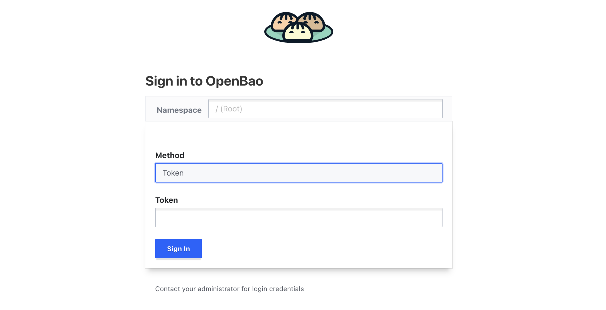
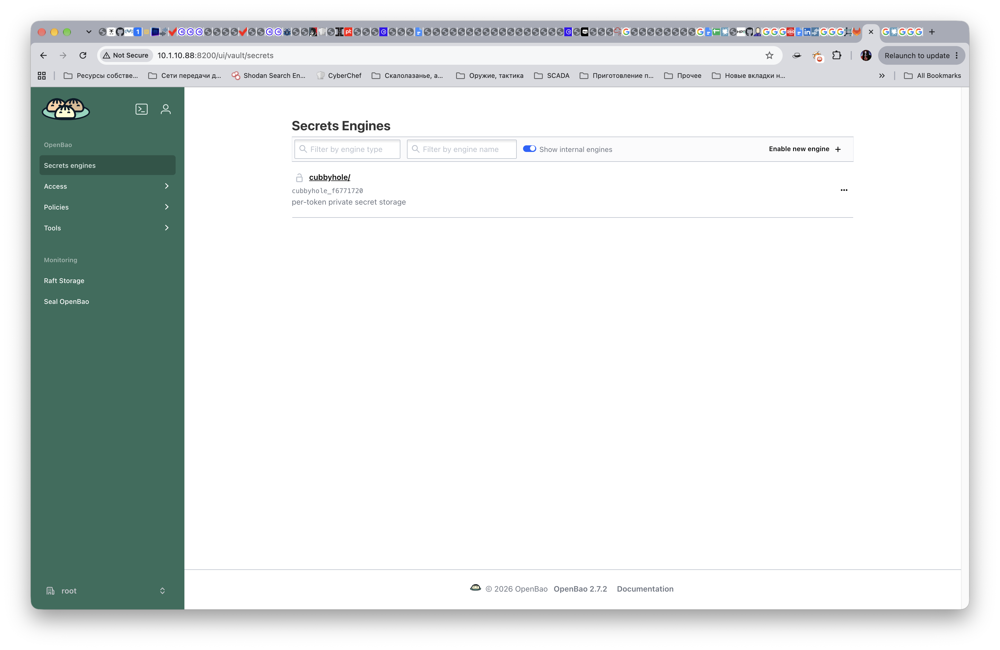

# OpenBAO
[OpenBao](https://openbao.org/docs/) является открытым форком HashiCorp Vault (под лицензией MPL 2.0), он полностью совместим с его API, клиентами и коллекциями Ansible (`community.hashi_vault`), но при этом не имеет лицензионных ограничений.

OpenBao (открытый форк HashiCorp Vault) спроектирован как универсальное зашифрованное хранилище секретов, а не только как инструмент для CI/CD. Для хранения статических учетных данных используется встроенный механизм KV (Key-Value) Secrets Engine.

Как работает OpenBao:
- **Движок KV (Key-Value)**. Это основной инструмент для хранения паролей от внешних сервисов. Внутри него создается произвольная структура папок (путей), например `secret/external-accounts/aws` или `secret/services/mail`, и записываются туда пары «ключ-значение», которые могут быть логином, паролем, токенено, URL'ом и т.д.
- **Версионирование (KV v2)**. Вторая версия движка автоматически сохраняет историю изменений. Если кто-то случайно перезаписал пароль, напроимер, от внешнего аккаунта, то можно легко посмотреть старое значение или откатиться к предыдущей версии.
- **Гибкое разграничение прав (Policies)**. С помощью политик доступа можно разрешить конкретному человеку или сервису читать пароли только из определенной ветки (например, только из `secret/marketing/*`), закрыв доступ ко всем остальным.
- **Полный аудит**. OpenBao записывает в лог каждое обращение к секрету: кто, когда и с какого IP-адреса запрашивал конкретный пароль.

Сценарии использования для внешних аккаунтов:
1. **Для приложений и скриптов**. Скрипты автоматизации, бэкапы или CI/CD-пайплайны (в том числе и GitLab Runner, настраиваемый в соответствующей [части](https://github.com/abeskrovny/IaaC/blob/main/GitLab.md)) могут забирать пароли от внешних API и сервисов напрямую из OpenBao по API перед запуском задачи, не храня их в коде.
2. **Для команды (как корпоративный менеджер паролей)**. Сотрудники могут заходить в веб-интерфейс (UI) OpenBao под своими учетными записями (например, через LDAP, OIDC или по токенам) и безопасно брать нужные логины и пароли от общих внешних аккаунтов.

Ограничения, которые стоит учитывать:
- **Нет автозаполнения в браузере**. В отличие от классических менеджеров паролей (Bitwarden, KeePass, 1Password), у OpenBao нет браузерных расширений для автоматической подстановки логинов на сайтах. Пароли придется копировать из веб-интерфейса или забирать через CLI/API.
- **Нет автоматической ротации для внешних сайтов**. Для внутренних баз данных (PostgreSQL, MySQL) OpenBao умеет сам менять пароли по расписанию. Для сторонних веб-сервисов пароли придется обновлять в хранилище вручную после их смены на самом сайте.

## Установка и настройка в Docker-среде
Подготовим директории для конфигурации и данных:
```
cd /opt && sudo mkdir -p /opt/openbao-docker/{config,data}
```

Создаем файл конфигурации `/opt/openbao-docker/config/config.hcl`:
```hcl
ui = true
disable_mlock = true

storage "raft" {
  path    = "/openbao-docker/data"
  node_id = "node1"
}

listener "tcp" {
  address     = "0.0.0.0:8200"
  tls_disable = 1 # Для стенда; в продакшене рекомендуется подключить TLS-сертификаты
}

api_addr = "http://127.0.0.1:8200"
cluster_addr = "https://127.0.0.1:8201"
```

и файл сборки `/opt/openbao-docker/docker-compose.yml`:
```yaml
services:
  openbao:
    image: openbao/openbao:latest
    container_name: openbao
    restart: unless-stopped
    ports:
      - "8200:8200"
    volumes:
      - ./config:/openbao/config:ro
      - ./data:/openbao/data
    cap_add:
      - IPC_LOCK
    command: server -config=/openbao-docker/config/config.hcl
```

Запускаем контейнер:
```bash
cd /opt/openbao-docker && sudo docker compose up -d
```

Процесс `OpenBao` внутри контейнера запускается от имени системного пользователя `openbao` (обычно имеет `UID 100` и `GID 1000`), но примонтированная директория на хосте принадлежит пользователю `root`. Необходимо поправить права доступа, чтобы контейнер корректно запустился:
```bash
sudo chown -R 100:1000 /opt/openbao/
```

Далее необходимо произвести первичную инициализацию, используя команду `docker exec -e BAO_ADDR='http://127.0.0.1:8200' openbao bao operator init`. Команда выдаст 5 ключей "распечатывания" (Unseal Keys) и 1 Root Token. Их надо сохранить в надежном месте:
```bash
admin@srvOoBService01:/opt/openbao$ sudo docker exec -e BAO_ADDR='http://127.0.0.1:8200' openbao bao operator init
Unseal Key 1: MawDj/6mhwc/xgSdhi+/xzz6Yo6JAyw9bLBPlsmcJJKk
Unseal Key 2: bWXvaVneC6cNrxzKElbaZlGLiBNRf080BBd2CJvejYSN
Unseal Key 3: /RnJZOLyJvyiLKyn1bM8J9yzKk9PcHeK39NM7SaHeHlH
Unseal Key 4: ZrXkCf+udNIfr3xCzm0+0uF+LApWU8cBIoJrLVf19bNB
Unseal Key 5: EXtflYnZRj4BJN45a8Ow7P4QAcUNJ+oQYbop03+By/Lq

Initial Root Token: s.I41MOy4VdBL1LluI12UkNnzR

Vault initialized with 5 key shares and a key threshold of 3. Please securely
distribute the key shares printed above. When the Vault is re-sealed,
restarted, or stopped, you must supply at least 3 of these keys to unseal it
before it can start servicing requests.

Vault does not store the generated root key. Without at least 3 keys to
reconstruct the root key, Vault will remain permanently sealed!

It is possible to generate new unseal keys, provided you have a quorum
of existing unseal keys shares. See "bao operator rotate-keys" for more
information.
```

> В реальной инфраструктуре публиковать ключи шифрования и токены в открытом доступе категорически запрещено. Однако в данном случае мы работаем в изолированной тестовой среде EVE-NG, поэтому для наглядности примера я оставлю эти данные незамаскированными.

После запуска OpenBao находится в запечатанном (Seal) режиме. Необходимо распечатать (Unseal) хранилище, выполнив команду `docker exec -it -e BAO_ADDR='http://127.0.0.1:8200' openbao bao operator unseal` три раза подряд, каждый раз вводя один из пяти полученных ключей (я буду использовать первые 3):
```bash
admin@srvOoBService01:/opt/openbao$ sudo docker exec -it -e BAO_ADDR='http://127.0.0.1:8200' openbao bao operator unseal      
Unseal Key (will be hidden): MawDj/6mhwc/xgSdhi+/xzz6Yo6JAyw9bLBPlsmcJJKk
Key                Value
---                -----
Seal Type          shamir
Initialized        true
Sealed             true
Total Shares       5
Threshold          3
Unseal Progress    1/3
Unseal Nonce       498e81eb-87e1-46f0-835a-40602954a1f6
Version            2.7.2
Commit Date        2026-10-26T20:32:27Z
Storage Type       raft
HA Enabled         true

admin@srvOoBService01:/opt/openbao$ sudo docker exec -it -e BAO_ADDR='http://127.0.0.1:8200' openbao bao operator unseal
Unseal Key (will be hidden): bWXvaVneC6cNrxzKElbaZlGLiBNRf080BBd2CJvejYSN
Key                Value
---                -----
Seal Type          shamir
Initialized        true
Sealed             true
Total Shares       5
Threshold          3
Unseal Progress    2/3
Unseal Nonce       498e81eb-87e1-46f0-835a-40602954a1f6
Version            2.7.2
Commit Date        2026-10-26T20:32:27Z
Storage Type       raft
HA Enabled         true

admin@srvOoBService01:/opt/openbao$ sudo docker exec -it -e BAO_ADDR='http://127.0.0.1:8200' openbao bao operator unseal
Unseal Key (will be hidden): /RnJZOLyJvyiLKyn1bM8J9yzKk9PcHeK39NM7SaHeHlH
Key                     Value
---                     -----
Seal Type               shamir
Initialized             true
Sealed                  false
Total Shares            5
Threshold               3
Version                 2.7.2
Commit Date             2026-10-26T20:32:27Z
Storage Type            raft
Cluster Name            vault-cluster-0b3b220a
Cluster ID              cdb00cd4-8ad4-f5de-0365-5b869c5ef036
HA Enabled              true
HA Cluster              n/a
HA Mode                 standby
Raft Committed Index    26
Raft Applied Index      26
```

После этого веб-интерфейс станет доступен по адресу `http://<IP_сервера>:8200/ui`:



Войти в систему можно через WEB-инрерфейс, с использованием токена указав `Initial Root Token` в поле Token (он начинается с `hvs.` или `s.` и был получен в терминале во время первоначальной инициализации `bao operator init`), либо можно использовать CLI контейнера, о чем речь пойдет ниже.

Если вдруг на указанном порту возникают проблемы с доступом, необходимо проверить наличие строки `ui = true` в `config/config.hcl` и, в случае необходимости, перезапустить контейнер.

## Стратегия резервного копирования
Стратегия резервного копирования OpenBao в Docker напрямую зависит от того, какой бэкенд хранения (`storage`) прописан в `config/config.hcl`.

Для небольших инсталляций, Docker-окружений и кластеров без сложной внешней обвязки лучше всего выбрать Integrated Storage (Raft) — этот вариант уже используется в текущей конфигурации. Он не требует сторонних сервисов, поддерживает отказоустойчивость (HA) «из коробки» и позволяет делать горячие бэкапы одной командой.

Следует отметить, что OpenBao (наследуя архитектуру HashiCorp Vault) поддерживает несколько типов хранилищ, которые делятся на встроенные и внешние. Все данные, записываемые в любой из этих бэкендов, предварительно шифруются самим OpenBao, поэтому хранилище видит только зашифрованные бинарные блоки.

_Таблица. Сравнение основных бэкендов хранения OpenBao_

| **Бэкенд** | **Тип и архитектура** | **Отказоустойчивость (HA)** | **Сложность обслуживания** | **Резервное копирование** |
|:---:|---|:---:|:---:|---|
| **Raft (Integrated Storage)** | Встроенное распределенное хранилище (на базе BoltDB) | **Да** (кластер из 3 или 5 нод) | **Низкая**: всё внутри одного бинарника/контейнера | Встроенная команда `raft snapshot save` без остановки |
| **PostgreSQL** | Внешняя реляционная СУБД | **Да**, если база в HA-кластере, например, Patroni | **Средняя**: нужно отдельно администрировать и обновлять БД | Стандартный `pg_dump` или PITR-бэкапы самой СУБД |
| **File (Filesystem)** | Локальные файлы на диске контейнера/хоста | **Нет**: строго одна нода | **Минимальная**: просто папка на диске | Только холодный бэкап (остановка контейнера и архивация) |
| **Consul** | Внешнее распределенное KV-хранилище | **Да** | **Высокая**: требует развертывания отдельного кластера Consul | Снапшоты Consul (`consul snapshot save`) |
| **In-Memory** | Хранение в оперативной памяти | **Нет** | **Нулевая**: данные пропадают при рестарте | Невозможно (только для автотестов) |

> Примечание: В отличие от старых версий оригинального Vault, из OpenBao удалены многие проприетарные и устаревшие облачные бэкенды вроде AWS DynamoDB, Azure Storage или etcd, чтобы сфокусироваться на самых надежных и открытых вариантах.

В качестве рекомендуемых, можно предлождить следующие варианты:
1. **Для текущего стенда в Docker и небольшого продакшена** raft - рекомендуемый выбор. Это официальный стандарт для современных инсталляций OpenBao. Даже если сейчас запущен всего один контейнер, использование Raft дает возможность делать консистентные «горячие» снапшоты и при необходимости в будущем легко добавить еще 2 ноды для высокой доступности.

2. **Если в инфраструктуре уже есть отказоустойчивый кластер БД** — postgresql. Если команда DBA уже поддерживает высокодоступный кластер PostgreSQL с настроенным резервным копированием по расписанию и мониторингом, логично положить данные OpenBao туда. Это снимает с админов задачу по настройке отдельного бэкапа для OpenBao.

3. **Для локальной разработки и быстрых тестов** — file или inmem: максимально простая конфигурация без лишних параметров. Но для реального хранения секретов file не рекомендуется из-за отсутствия масштабирования и невозможности безопасно снять бэкап на лету.

### Создание бэкапа
Бэкап состоит из двух обязательных компонентов: снапшота данных (делается регулярно) и статических артефактов (сохраняются один раз при настройке).

#### Шаг 1. Подготовка
Данный шаг выполняется один единственный раз.

Необходимо сохранить в надежном месте отдельно от сервера с OpenBao, например, в офлайн-сейф или защищенный менеджер паролей:
1. **Ключи распечатывания (Unseal Keys)**, полученные при первоначальной инициализации. Без них восстановленный снапшот невозможно будет расшифровать.
2. **Конфигурацию запуска**: файлы `config.hcl` и `docker-compose.yml`.

#### Шаг 2. Снятие горячего снапшота базы
На работающем в штатном режиме контейнере на стороне хост-машины выполняем следующую команду:
```bash
sudo docker exec -e BAO_ADDR='http://127.0.0.1:8200' -e BAO_TOKEN='s.I41MOy4VdBL1LluI12UkNnzR' openbao \
  bao operator raft snapshot save /openbao/data/openbao_$(date +%F_%H-%M).snap
```

> Примечание: Так как /openbao/data примонтирована к хосту (например, в /opt/openbao/data), готовый файл .snap сразу появится на диске хост-машины.

В результате чего получим:
```bash
admin@srvOoBService01:/opt/openbao$ ls -la data/openbao_2026-11-19_18-58.snap 
-rw------- 1 usbmux window 16921 Nov 19 18:58 data/openbao_2026-11-19_18-58.snap
```

#### Шаг 3. Выгрузка бэкапа во внешнее хранилище
Далее необходимо перенести полученный .snap-файл на внешний сервер бэкапов, в S3-бакет или сетевую шару, после чего удалить локальный файл из папки `/opt/openbao/data`.

### Восстановление из бэкапа
Восстановление производится достаточно просто, при этом, если нужно только восстановить бэкап, то необходимо начинать с шага 4.

#### Шаг 1. Подготовка на новом сервере
Если требуется восстановить OpenBAO на новом сервере, необходимо создать инфраструктуру каталогов, как описано в части [Установка и настройка в Docker-среде](#установка-и-настройка-в-docker-среде), а также восстановить сохраненные ранее `config.hcl` и `docker-compose.yml` в соответствующих каталогах.

#### Шаг 2. Запуск чистого контейнера
Если это новый, пока еще пустой экземпляр OpenBao, то необходимо запустить контейнер:
```bash
cd /opt/openbao && sudo docker compose up -d
```

#### Шаг 3. Первичная инициализация и распечатывание нового инстанса
Чтобы API OpenBao стало доступно для загрузки снапшота, новый контейнер нужно инициализировать и распечатать (эти временные ключи сразу же перезапишутся при восстановлении снапшота):
```bash
sudo docker exec -e BAO_ADDR='http://127.0.0.1:8200' openbao bao operator init
```

Далее, распечатываем его с помощью новых (временных) Unseal Keys 3 раза с разными ключами:
```bash
sudo docker exec -e BAO_ADDR='http://127.0.0.1:8200' openbao bao operator unseal <ВРЕМЕННЫЙ_КЛЮЧ>
```

В принципе, после распечатывания хранилища, инициализационные ключи теряют свою значимость, но временный Initial Root Token еще понадобится на следующем шаге.

#### Шаг 4. Загрузка снапшота
На данном шаге необходимо скопировать файл бэкапа (.snap) в папку данных `/opt/openbao/data/backup.snap` на хосте и, затем, выполнить команду принудительного восстановления, используя временный Root Token (если производится восстановление на новом сервере):
```bash
sudo docker exec -e BAO_ADDR='http://127.0.0.1:8200' -e BAO_TOKEN='ВРЕМЕННЫЙ_ROOT_ТОКЕН' openbao \
  bao operator raft snapshot restore -force /openbao/data/backup.snap
```

#### Шаг 5. Финальное распечатывание старыми ключами
После команды `restore`, OpenBao автоматически перейдет в запечатанное состояние (Sealed: true), так как мастер-ключ шифрования вернулся от старого сервера.

Для продолжения работы, необхоидимо распечатать хранилище, используя исходные Unseal Keys от старого сервера (3 раза):
```bash
sudo docker exec -e BAO_ADDR='http://127.0.0.1:8200' openbao bao operator unseal <СТАРЫЙ_КЛЮЧ>
```

после чего старый архив `backup.snap` можно будет удалить. A OpenBao будет полностью готов к работе: все секреты, политики, пользователи и старые токены будут доступны по прежним адресам.

## Использование OpenBAO в качестве корпоративного менеджера паролей
OpenBao отлично подходит на роль единого корпоративного менеджера паролей для IT-команд и DevOps-инженеров, позволяя хранить чувствительные данные в одном месте как для людей (через веб-интерфейс), так и для скриптов автоматизации (через API), что будет рассмотрено далее.

В типовой инфраструктуре учетные данные часто размазаны по разным инструментам: пароли от сетевого оборудования и серверов лежат в KeePass или таблицах, токены от внешних сервисов — в личных заметках сотрудников, а секреты для CI/CD — в переменных окружения. Перенос всех этих данных в OpenBao закрывает сразу две задачи:
1. **Единая точка хранения (Single Source of Truth для секретов)**: И инженеры, и автоматизация (Ansible, GitLab CI, Terraform) обращаются к одному и тому же хранилищу. При смене пароля на устройстве его достаточно обновить один раз в OpenBao.
2. **Контроль и аудит доступа**: В отличие от локальных файлов с паролями, OpenBao фиксирует в журнале аудита каждое обращение к секрету — кто, когда и какой именно пароль просматривал.

Чтобы превратить OpenBao в удобный и безопасный корпоративный сейф, настройку строят вокруг четырех базовых элементов:
1. **Структура хранения**;
2. **Модель аутентификации**;
3. **Разграничение прав доступа**;
4. **Повседневная работа через Web UI**.

Дальнейшие действия в данной части я предпочитаю производить в WEB-UI. Залогинившись под пользователем `root` через WEB-интерфейс, мы получим следующий экран:



на котором будет присутствовать только хранилище `Cubbyhole` (если активировать чек-бокс "Show internal engines") — это специальный встроенный движок секретов (раздел `cubbyhole/`), который работает как личный сейф конкретного токена, соблюдая, при этом, следующие правила:
- **Строгая изоляция**: Доступ к данным внутри `cubbyhole/` имеет только тот токен, который их туда записал. Никакой другой пользователь — даже администратор с Root Token — не может прочитать чужой `cubbyhole` напрямую.
- **Время жизни равно жизни токена**: Как только срок действия токена истекает или его отзывают, все данные в его персональном `cubbyhole` безвозвратно удаляются.
- **Используется**: Для временного хранения личных данных во время сессии и для безопасной передачи секретов между сервисами по паттерну Response Wrapping (когда секрет упаковывается в одноразовый временный токен с коротким TTL).

### Структуры хранения
OpenBao поддерживает достаточно много структур хранения из которых, на данном этапе, мне интересны следующие 4, составляющих базу, закрывающую около 80% стандартных задач инфраструктуры и безопасности. Эти модули покрывают хранение статических секретов, управление доступом к серверам, шифрование данных «на лету» и двухфакторную аутентификацию.

Вот краткий разбор того, какие задачи решает каждый из них и на что стоит обратить внимание при внедрении:

| **Движок** | **Основное назначение** | **Ключевая особенность** |
|:---:|---|---|
| **KV (Key-Value)** | Хранение статических секретов: паролей, токенов API, сертификатов, конфигов и т.п. | В KV v2 поддерживается версионирование, мягкое удаление (soft delete) и метаданные |
| **SSH** | Централизованное управление доступом к серверам по SSH | Лучше использовать режим Signed SSH Certificates (подпись открытых ключей), а не одноразовые пароли (OTP) |
| **Transit** | «Шифрование как сервис» (Encryption as a Service) | Приложения отправляют данные в OpenBao для шифрования/дешифрования, не имея прямого доступа к самим ключам |
| **TOTP** | Генерация и валидация одноразовых паролей по времени (2FA) | Может работать как генератор кодов для внешних сервисов, так и как сервер проверки для ваших приложений |

Далее разберем их более детально.

#### Создание и работа со структурой данных Key-Value
Key-Value в OpenBao — это фундаментальный движок секретов, представляющий собой распределенное зашифрованное хранилище типа «ключ-значение». Для корпоративного использования стандартом де-факто является KV v2, который превращает простое хранилище в полноценную систему управления жизненным циклом статических секретов. Его ключевые характеристики включают версионирование (с возможностью настроить лимит хранимых версий), мягкое удаление (soft delete) с возможностью восстановления данных, механизм Check-and-Set (CAS) для защиты от перезаписи при конкурентном доступе, а также поддержку метаданных и автоматического удаления секретов по истечении заданного времени (TTL).

В корпоративной среде это позволяет внедрить строгий аудит и гранулярный контроль доступа через ACL-политики, разделяя секреты по департаментам, проектам и окружениям (`prod`, `stage`, `dev`) без риска безвозвратной потери критически важных паролей или токенов из-за человеческой ошибки.

При интеграции с NetBox и GitLab в рамках GitOps-подхода KV закрывает проблему безопасного связывания декларативного состояния инфраструктуры и секретов. NetBox, выступая в роли "источника правды" для сетевой топологии и инвентаризации, хранит в себе не сами пароли или SNMP-комьюнити, а лишь ссылки (пути) на соответствующие записи в OpenBao, либо использует KV для защиты собственных токенов вебхуков и API-ключей при синхронизации с внешними системами.

В свою очередь, GitLab CI/CD интегрируется с OpenBao через нативный механизм OIDC (JWT-аутентификация): джоб пайплайна предъявляет криптографически подписанный токен, OpenBao проверяет его утверждения (например, ветку `main` или конкретный проект) и выдает короткоживущий токен с правами на чтение нужной ветки KV. Это позволяет безопасно доставлять секреты в Kubernetes-кластеры (например, через External Secrets Operator) или Terraform-стейты, полностью исключая хранение статических секретов в переменных окружения GitLab.

В экосистеме Ansible движок KV выступает единым источником правды чувствительных данных, избавляя от необходимости хранить зашифрованные файлы `ansible-vault` непосредственно в Git-репозиториях. С помощью стандартных lookup-плагинов (таких как `community.hashi_vault.vault_kv2_get`) плейбуки в реальном времени забирают пароли администраторов, ключи API или сертификаты в момент выполнения задач. Аутентификация самого управляющего узла Ansible при этом строится через AppRole или JWT/OIDC, а полученные секреты автоматически маркируются флагом `no_log: true`, чтобы исключить их попадание в логи выполнения. Такой подход упрощает ротацию учетных данных: достаточно обновить значение по нужному пути в OpenBao, и при следующем запуске конфигураций Ansible применит актуальные параметры без изменения кода плейбуков.


----

Это дополнительные настройки монтирования движка секретов. Они управляют описанием, видимостью, временем жизни токенов/секретов, логированием аудита и передачей HTTP-заголовков.

Общие настройки и видимость

• Description — текстовое описание этого движка секретов или метода аутентификации (например, «Секреты продакшн-кластера»). Помогает администраторам ориентироваться в интерфейсе, но ни на что не влияет технически.
• List method when unauthenticated — определяет, будет ли этот движок/метод отображаться в списке доступных точек монтирования для неаутентифицированных пользователей (например, на экране входа в UI). По умолчанию отключено из соображений безопасности.

Время жизни (TTL)

Время жизни (TTL — Time To Live) в OpenBao / Vault определяет, как долго сгенерированный токен или динамический секрет остается действительным, прежде чем система автоматически его отзовет (уничтожит).
Главная цель TTL — минимизировать ущерб при утечке данных: даже если злоумышленник перехватит пароль или токен, он перестанет работать через короткое время.

Как работают Default и Max TTL

• Default Lease TTL (время жизни по умолчанию) — срок, на который выдается секрет или токен, если приложение при запросе не попросило конкретное время.
• Max Lease TTL (максимальное время жизни) — жесткий потолок. Приложение может продлевать (обновлять) свой токен или секрет, пока не упрется в этот лимит. После достижения Max TTL продление невозможно — нужно запрашивать новый секрет заново.


• Default Lease TTL (OpenBao will use the default lease duration) — время жизни аренды (lease) по умолчанию для секретов или токенов, выдаваемых этим движком. Если поле оставлено пустым, OpenBao использует глобальную системную настройку (обычно 768 часов / 32 дня).
• Max Lease TTL (OpenBao will use the default lease duration) — максимально допустимое время жизни аренды, которое может запросить клиент. Если не задано, берется глобальный лимит сервера.


Примеры использования на практике


1. Динамические пароли для баз данных (Database Secrets Engine)

Вместо одного вечного пароля от PostgreSQL для бэкенда OpenBao создает временного пользователя БД на лету.
• Настройка: Default TTL = 1h (1 час), Max TTL = 24h (24 часа).
• Как работает: Приложение запускается и просит доступ к БД. OpenBao создает пользователя v-app-98a7f со сроком жизни 1 час. Пока приложение работает, оно каждые 40 минут отправляет запрос на продление (renew). Через 24 часа (Max TTL) OpenBao принудительно удалит этого пользователя из PostgreSQL, и приложение должно будет запросить нового.
• Польза: Если сервер взломают и украдут пароль из памяти, через час (или максимум через сутки) он превратится в «тыкву».

2. Токены аутентификации для CI/CD (например, GitLab CI или GitHub Actions)

Когда запускается пайплайн деплоя, ему нужен временный токен OpenBao, чтобы забрать ключи для выкладки кода на сервер.
• Настройка: Default TTL = 5m (5 минут), Max TTL = 15m (15 минут).
• Как работает: Сборочный агент авторизуется в OpenBao и получает токен на 5 минут. Этого хватает, чтобы скачать нужные сертификаты и завершить сборку. Если задача зависла, она может продлить токен максимум до 15 минут.
• Польза: Даже если токен случайно попадет в логи сборки, к моменту, когда кто-то их прочитает, токен уже будет недействителен.


4. Особенность для KV (Key-Value) хранилища

Для обычных статичных секретов (как в вашем первом вопросе, где хранятся заранее заданные пароли или API-ключи) TTL почти не работает. OpenBao не может сам пойти в сторонний сервис (например, в Telegram или AWS) и поменять там ваш статичный API-ключ. Поэтому для KV-движка параметры Default Lease TTL и Max Lease TTL обычно оставляют по умолчанию (0s).


Безопасность аудита (Audit HMAC)

По умолчанию OpenBao хеширует (через HMAC) все чувствительные данные в логах аудита, чтобы секреты не утекали в файлы логов в открытом виде. Эти два поля позволяют сделать исключения:
• Request keys excluded from HMACing in audit — список ключей (полей) в входящих запросах, которые не нужно хешировать при записи в аудит-лог. Они будут записаны в лог открытым текстом (полезно для отладки несекретных параметров, например, username или role).
• Response keys excluded from HMACing in audit — список ключей в ответах сервера, которые не нужно хешировать в логах аудита (например, accessor или ttl).

Настройка HTTP-заголовков

OpenBao по умолчанию фильтрует большинство HTTP-заголовков при проксировании запросов к плагинам или движкам. Эти поля настраивают белый список:
• Allowed passthrough request headers — список HTTP-заголовков из входящего запроса клиента, которые OpenBao разрешит передать дальше напрямую в сам движок секретов или плагин.
• Allowed response headers — список HTTP-заголовков, которые движок секретов или плагин может вернуть обратно клиенту в ответе OpenBao.


Это стандартные параметры настройки секретного хранилища (Secrets Engine) типа Key-Value (KV) в HashiCorp Vault.

Базовые параметры движка

• Type: kv — тип движка секретов (Key-Value). Он используется для хранения произвольных статичных секретов (паролей, токенов, API-ключей) в формате «ключ — значение».
• Path: kv/ — путь монтирования (mount path), по которому этот движок доступен в Vault. Все запросы на чтение и запись секретов будут начинаться с этого префикса (например, vault kv get kv/my-secret).
• Accessor: kv_894dc3be — уникальный внутренний идентификатор этого экземпляра движка. Vault генерирует его автоматически для привязки политик доступа и аудит-логов, даже если путь монтирования позже изменится.

Настройки времени жизни (TTL)

• Default Lease TTL: 0s — время жизни аренды (lease) секрета по умолчанию. Значение 0s означает, что используется глобальное системное значение Vault (обычно 768 часов / 32 дня), но для KV-движка это почти не играет роли, так как статичные секреты не отзываются автоматически по истечении времени.
• Max Lease TTL: 0s — максимальное время жизни аренды, которое может запросить клиент. Как и в случае с Default TTL, 0s наследует глобальную настройку сервера.

Специфичные настройки KV Version 2

• Version: 2 — версия движка. Вторая версия (в отличие от первой) поддерживает версионирование секретов (историю изменений), мягкое удаление (возможность восстановить удаленный секрет) и метаданные.
• Require Check and Set: False — требование использования механизма Check-and-Set (CAS). Когда стоит False, любой пользователь с правами на запись может перезаписать секрет без указания его текущей версии. Если включить (True), для обновления секрета нужно будет явно передавать номер его последней версии (это защищает от случайной перезаписи данных при одновременной работе).
• Automate secret deletion: Never delete — автоматическое безвозвратное удаление старых версий секретов по истечении определенного времени. Значение Never delete означает, что старые версии хранятся бессрочно, пока их не удалят вручную.
• Maximum number of versions: Not set — лимит на количество хранимых версий для одного секрета. Так как значение не задано (Not set), используется глобальная настройка Vault (по умолчанию хранятся последние 10 версий). При превышении лимита самая старая версия автоматически удаляется.

----

ssh

Это экран подключения (включения) SSH Secrets Engine в OpenBao — движка, который позволяет безопасно управлять доступом к Linux-серверам по SSH с помощью одноразовых паролей или подписанных SSH-сертификатов вместо статичных ключей в authorized_keys.
Ниже разбор каждого поля на этой странице (обратите внимание, что вторая половина настроек — это стандартные системные параметры монтирования, как и для других движков):

Основные настройки SSH-движка

• Enable a Secrets Engine — заголовок режима создания нового движка секретов.
• Path: ssh — путь в URL и CLI, по которому будет доступен этот движок (например, bao write ssh/sign/my-role ...). Если у вас несколько изолированных сред (например, prod и dev), вы можете задать пути ssh-prod и ssh-dev.
• Description — произвольное текстовое описание для администраторов (например, «Подпись SSH-ключей для продакшн-серверов»).

Видимость и время жизни (TTL)

• List method when unauthenticated — галочка, определяющая, будет ли путь ssh/ виден в списке доступных движков тем, кто еще не вошел в OpenBao. Обычно оставляют выключенной.
• Default Lease TTL (OpenBao will use the default lease duration) — срок действия выдаваемого SSH-сертификата или одноразового пароля по умолчанию, если пользователь не запросил другое время. Если не менять, возьмется системное значение (32 дня), поэтому для SSH здесь настоятельно рекомендуется задать короткий срок (например, 30m или 8h — на один рабочий день).
• Max Lease TTL (OpenBao will use the default lease duration) — максимально возможный срок жизни SSH-доступа, который может запросить пользователь (например, 24h).

Параметры аудита и HTTP-заголовков (системные)

• Request keys excluded from HMACing in audit — список полей из входящего запроса, которые нужно записывать в лог аудита открытым текстом, не хешируя (например, public_key или valid_principals, чтобы в логах было видно, кто и для какого пользователя запрашивал SSH-доступ).
• Response keys excluded from HMACing in audit — список полей из ответа OpenBao, которые не будут хешироваться в логах аудита.
• Allowed passthrough request headers — белый список HTTP-заголовков, которые OpenBao передаст от клиента напрямую в SSH-движок.
• Allowed response headers — белый список HTTP-заголовков, которые SSH-движок может вернуть клиенту.

Как работает SSH-движок на практике

Чаще всего его используют в режиме Signed SSH Certificates (подписанные сертификаты):
1. На целевые серверы один раз добавляется публичный ключ центра сертификации (CA) OpenBao.
2. Разработчик или администратор отправляет свой обычный публичный ключ (id_ed25519.pub) в OpenBao.
3. OpenBao проверяет права пользователя и возвращает подписанный сертификат со сроком жизни (тем самым TTL), например, на 4 часа.
4. Через 4 часа сертификат превращается в недействительный, и доступ на сервер автоматически закрывается без необходимости удалять ключи с серверов вручную.


---

totp/ — это путь монтирования для движка секретов TOTP (Time-based One-Time Password) в OpenBao, который используется для генерации и проверки одноразовых паролей, зависящих от времени (как в Google Authenticator или Яндекс Ключ).
Этот движок позволяет использовать OpenBao как централизованный и безопасный генератор кодов двухфакторной аутентификации (2FA) для людей и автоматизированных систем.

Два основных сценария работы totp/


1. OpenBao как генератор кодов (вместо телефона сотрудника)

Когда у команды есть общий аккаунт на внешнем сервисе (например, в облаке, у регистратора доменов или в банковском кабинете) с обязательной 2FA, хранить QR-код на телефоне одного сотрудника небезопасно и неудобно.
• Как работает: Секретный ключ (seed) от внешнего сервиса загружается в totp/.
• Результат: Любой сотрудник или CI/CD-скрипт, у которого есть права в OpenBao, может выполнить запрос к totp/code/имя_ключа и получить актуальный 6-значный код, не имея доступа к самому мастер-ключу 2FA.

2. OpenBao как сервер проверки 2FA для ваших приложений

Если вы разрабатываете собственное приложение и хотите добавить в него двухфакторную аутентификацию, вам не нужно писать логику генерации QR-кодов и проверки токенов с нуля.
• Как работает: Ваше приложение просит OpenBao создать новый ключ (totp/keys/user123), получает от него QR-код и показывает пользователю. Пользователь сканирует его телефоном.
• Результат: При входе пользователя приложение отправляет введенный им код в OpenBao (totp/code/user123), а OpenBao отвечает valid: true или valid: false.

Почему это безопаснее обычных приложений-аутентификаторов

• Разделение прав: Сотрудник может запрашивать временные 6-значные коды, но не может скопировать сам исходный секретный ключ (seed) и унести его на личный телефон.
• Аудит: Каждое получение кода фиксируется в логах аудита OpenBao — всегда видно, кто и когда запрашивал доступ.
• Автоматизация: Роботы и автотесты могут сами забирать 2FA-коды через API OpenBao для прохождения авторизации без участия человека.


----


## Использование OpenBAO в качестве источника секретов для приложений и скриптов


!!!Интеграция со всеми компонентами
